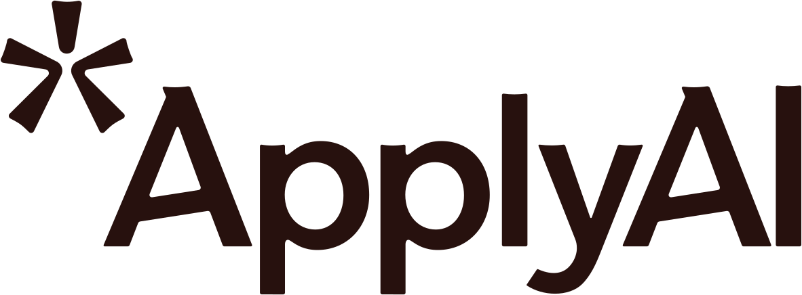
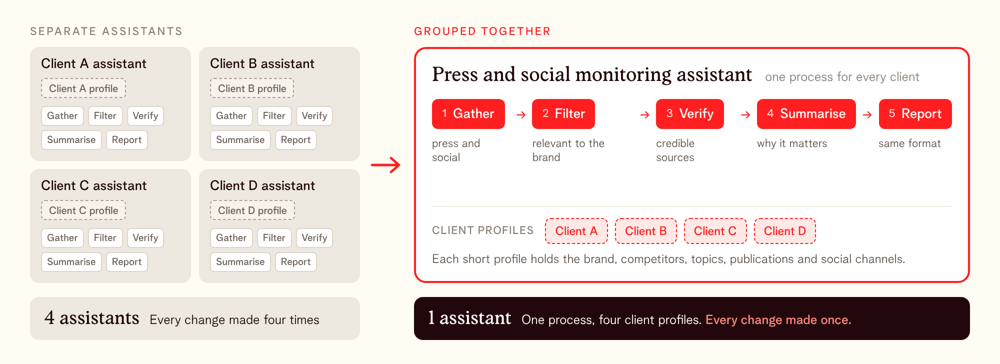

<p>
  <a href="https://applyai.uk"></a>
</p>

# Apply AI Skills Toolkit

**From scattered assistants to focused builds.** Four free skills for Claude and ChatGPT that replace a separate assistant for every client with one shared process and a short profile for each client.

From [AI Pulse](https://pulse.applyai.uk), Edition 13.



---

## The skills

| | Skill | What it does | Download |
|---|---|---|---|
| 01 | **Client monitoring** | Produces a daily or weekly press and social monitoring report for any client, using one shared process and that client's profile | [client-monitoring.zip](downloads/client-monitoring.zip) |
| 02 | **Client profile builder** | Researches a new client and drafts its profile with you | [client-profile-builder.zip](downloads/client-profile-builder.zip) |
| 03 | **New business signals** | Checks target brands for a new CMO, rebrand, agency review, funding or a campaign under pressure, with a suggested first line | [new-business-signals.zip](downloads/new-business-signals.zip) |
| 04 | **Monitoring calibrator** | Turns analyst feedback into a precise, ready-to-paste edit to the shared process, with a changelog entry | [monitoring-calibrator.zip](downloads/monitoring-calibrator.zip) |

[Download all skills](downloads/applyai-skills-all.zip). It contains one ZIP per skill. Unzip it once, then upload each skill's ZIP separately.

---

## What these skills can and cannot do

Please read this before you rely on them for client work.

### They can

- **Follow the same process for every client**, so reports are consistent whoever runs them
- **Search the public web** for press coverage and public social posts about a client, its competitors and its priority topics, using your AI platform's built-in web search
- **Filter, check and summarise** what they find, with a link to the original source for every item
- **Avoid repeating** items from the previous report, when that report is available in the same project or conversation
- **Run on a schedule** where your AI platform supports scheduled tasks, and fail safely with a clear one-line message if something is missing
- **Draft client profiles and suggested outreach lines** for a person to review
- **Propose exact edits** to the shared process when a report misses the mark

### They cannot

- **See behind paywalls or logins.** Paid publications and sites like LinkedIn usually can't be read. Items from them are marked `(headline only)` or flagged for the team to check by hand.
- **Guarantee they find everything.** Coverage depends on what your platform's web search returns. They support an analyst's judgement and do not replace it.
- **See every social post.** They can only read public posts that your platform's web search can reach. Private accounts, stories and most comments are out of reach. For full social listening, use a dedicated tool alongside them.
- **Monitor broadcast or print** unless that coverage is published on the open web.
- **Track numbers over time** or send alerts when mentions spike. Use a dedicated media or social monitoring tool for thresholds, and these skills to explain what happened.
- **Remember earlier runs on their own.** They only avoid repeats if the previous report is in the same project or conversation.
- **Send emails, post messages or contact anyone.** Every output is a draft for a person to review.
- **Change your files.** The calibrator proposes edits. A person approves and applies them.
- **Make decisions for you.** Check anything important against the source before acting on it.

### Your responsibilities

- Review reports before sharing them with clients.
- Keep client profiles free of confidential or personal information beyond names and public roles.
- Follow your organisation's policies on using AI platforms with client work.

---

## How it works

| Layer | File | What it holds |
|---|---|---|
| Process | `process.md` | The five stages (gather, filter, verify, summarise, report) and the standard for each, with a worked example of what to keep and what to leave out at every stage |
| Client | `client-profiles/*.md` | Brand, competitors, priority topics, social channels and approved sources, one short file per client |
| Output | `report-format.md` | The same report fields in the same order, every time |

The process and format are written once. Only the profile changes from client to client, so every improvement reaches every client. Templates are in [`templates/`](templates).

---

## Install

### Claude
1. In **Settings › Capabilities**, turn on file creation and code execution. On Enterprise plans, an owner enables Skills in organisation settings.
2. Go to **Customize › Skills**, select **+**, then **Create skill › Upload a skill**.
3. Upload the skill ZIP and make sure its toggle is on.
4. Create a Project called "Client monitoring" and add your client profiles.
5. Ask: "Run today's monitoring report for Northfield Coffee."

On Team and Enterprise plans, use **Share** or **Publish to org** from the skill's menu. [Claude help](https://support.claude.com/en/articles/12512180-use-skills-in-claude)

### ChatGPT
1. Select your profile icon and open **Skills** (paid plans; on Business and Enterprise your workspace owner may need to enable it).
2. Choose **Upload from your computer** and select the skill ZIP.
3. Create a Project called "Client monitoring" and upload your client profiles.
4. Ask for a report, then set a scheduled task to run it each morning.

No Skills option? Paste the contents of `SKILL.md` into your Project instructions and upload the files from its `references` and `assets` folders.

### Microsoft Copilot
Copilot doesn't install skill files directly. Unzip the skill, store its files and your client profiles in SharePoint, create a Copilot agent with the contents of `SKILL.md` as its instructions, and add the folder as its knowledge. For scheduled delivery to Teams or email, use Copilot Studio with Power Automate.

Menu names change from time to time. If a step has moved, check your platform's help centre.

---

## Test before you rely on it

Each skill has a short test set in [`tests/`](tests): the prompt to send, the setup it needs, and what a pass looks like. Run them after installing, and again after any change.

---

## Repository layout

```
applyai-skills/
├── index.html             toolkit page (GitHub Pages)
├── skills/                skill source folders (Agent Skills format)
│   ├── client-monitoring/
│   ├── client-profile-builder/
│   ├── new-business-signals/
│   └── monitoring-calibrator/
├── downloads/             one ZIP per skill, plus all skills
├── templates/             client profile, example profile, report format
├── tests/                 test prompts and pass criteria for each skill
└── assets/                fonts, logo, diagrams
```

---

Built by [Apply AI](https://applyai.uk). Questions, or results to share? [connect@applyai.uk](mailto:connect@applyai.uk)
